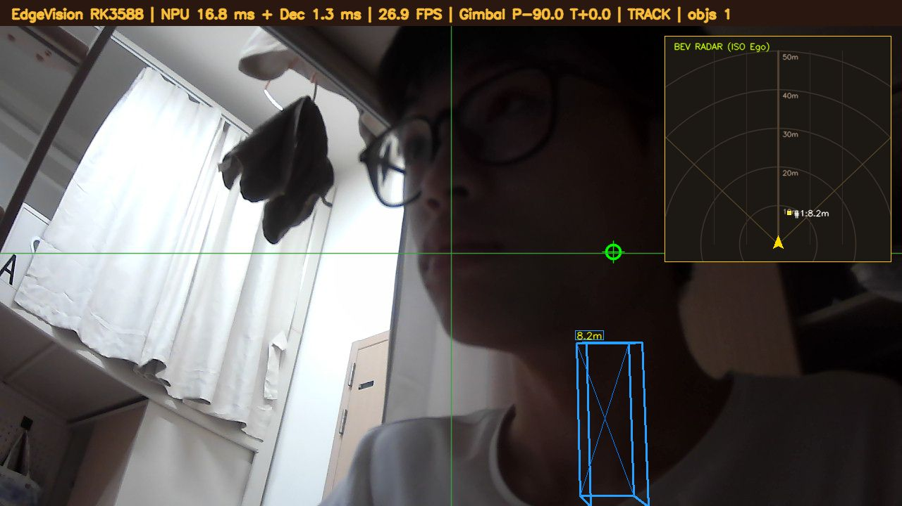
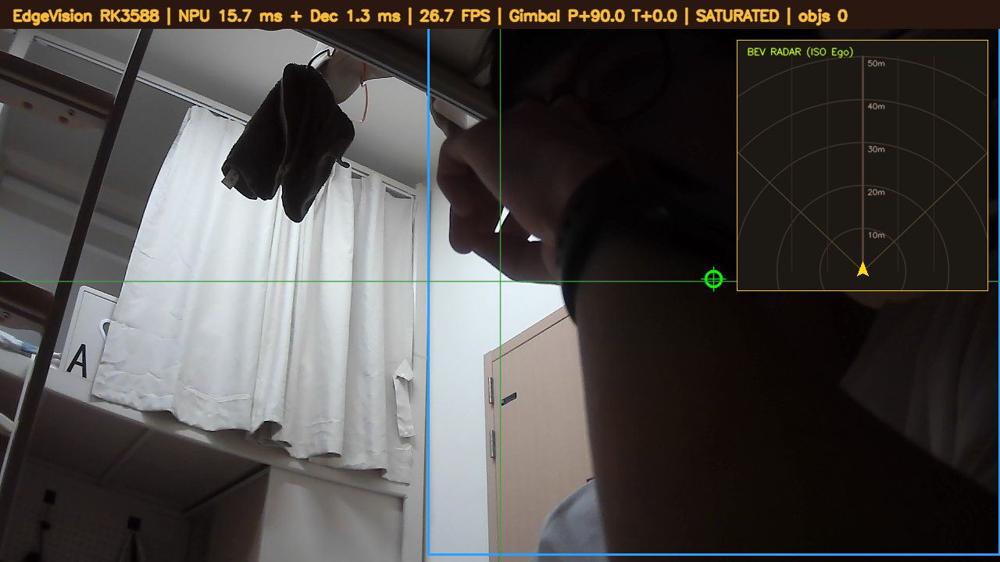

# ESP32-S3 舵机云台 — RK3588 视觉追踪执行器



*板端真实运行截图（`http://<board-ip>:8080`）：顶部 HUD 显示
`NPU 16.8 ms + Dec 1.3 ms | 26.9 FPS | Gimbal P-90.0 T+0.0 | TRACK | objs 1`
—— 绿色十字准星对准目标，蓝色 3D 线框贴着人被检出（8.2m），
右上 BEV 雷达显示目标距离 1.8m。**这是 RK3588 检测 + ESP32 舵机驱动的真闭环**，
不是仿真。*

> 状态栏里的 `TRACK` / `SATURATED` 是云台状态：
> **TRACK** = 正在跟踪目标；**SATURATED** = 舵机已顶到软限位（见下方"角度定义"）。

<details>
<summary>另一张：舵机顶到限位时的画面（<code>SATURATED</code>）</summary>



*`Gimbal P+90.0 T+0.0 | SATURATED | objs 0` —— pan 已转到 +90° 上限，
目标跑出画面，说明软限位生效。*

</details>

---

> **状态（2026-11-03 深夜）**：
> - ✅ 固件已烧录到真实 ESP32-S3 N16R8（PC 上枚举为 COM5），硬件自检 5/5 通过
> - ✅ 闭环逻辑 18 项自测全绿（PC 与**板端 Python 3.9** 都跑过）
> - ✅ 端到端联调通过（模拟网关 + 真串口 + 真板子，pan 跨度 137°）
> - ✅ **板端环境已就绪**：`/root/esp32_gimbal/`，pyserial 3.5 复用 `/root/rknn_env`
> - ✅ **真实 9000 网关已验证**：帧格式 248B 正确，坐标口径实测确认（见 8.4）
> - ✅ **★ 真视觉闭环已跑通**（2026-11-03 晚，见 8.6）：真网关 + 真串口 + 真舵机，
>   60 秒 223 条指令零错误，dx 从 +0.237 收敛进死区，77 次锁定
> - ✅ **★ 一体化追踪+预览已跑通**（见 8.7）：一个进程同时做 NPU 检测 + 9000 推流 +
>   8080 网页预览 + 串口驱动云台，26.8 FPS，浏览器实时看画面和云台状态
> - ⚠️ **pan 方向实测是反的，必须加 `--invert-pan`**（两次独立标定确认，见 8.6.1）
> - ⏳ **待办**：接第二颗 tilt 舵机（GPIO15，需独立 5V 电源）；舵机改独立供电

---

## 为什么需要这颗 MCU（这是整个方案的立论）

翻了 `rk3588开发板配套资料` 里的规格书和使用手册，**EVM3588-B 主板没有引出 40Pin GPIO，
也没有任何 PWM 引脚**。规格书列出的全部接口：

> 2×RS232、2×RS485、4×ADC、4×buttons、1×RTC、1×TF、1×SIM、1×FAN、3×LED、
> MINI-PCIE、PCIE3.0×4、SATA、M.2、USB2.0×2、USB3.0×2、HDMI_TX×2、HDMI_RX、DP、
> MIPI_CSI×4、MIPI_DSI×2

资源图（规格书 P5）也只画了 RS485/RS232、ADC×4、Buttons、FAN、LED、MINI-PCIE 这些。

所以 RK3588 **无法直接产生 SG90 要的 50Hz PWM**。这不是将就，是正确分层：

| | 谁干 | 周期 | 为什么 |
|:---|:---|:---|:---|
| **快层** | ESP32-S3 LEDC 硬件 PWM | 50Hz 连续 | 硬件定时器零抖动。Linux 非实时内核里 `usleep` 会被调度器打断，抖动直接打到舵机齿轮 |
| **慢层** | RK3588 做检测/决策 | 秒级 | 跑 NPU + LLM |

这和项目里「巡检守护快层不加载 LLM」是同一个设计哲学：实时的事交给实时的东西。

**没有采用飞线到核心板 BTB 引脚的方案**：那是 1.8V/3.3V 混排的板对板连接器，
飞线破坏可靠性且无官方支持。USB 串口是标准接口，可维护。

---

## 快速开始

### 前提

| 项 | 需要 |
|:---|:---|
| 主控板 | RK3588（本项目在 EVM3588-B 验证），跑视觉检测 |
| MCU | **ESP32-S3 N16R8**（ESP-IDF v6.0.1） |
| 执行器 | SG90 舵机（Pan 接 GPIO4，Tilt 接 GPIO5） |
| 接线 | 舵机红→**USB转TTL 的 5V**（★不能接板子 `5Vin`，那是输入脚）；三者共地 |
| 串口 | ESP32 的 USB 口接电脑/板子，枚举为 `/dev/ttyACM0` 或 COM 口 |

### 编译固件

```bash
# 需要先装 ESP-IDF v6.0.1 并 source export.sh
cd esp32-gimbal-rk3588
idf.py build
idf.py -p COM5 flash monitor        # Windows
idf.py -p /dev/ttyACM0 flash monitor  # Linux
```

或用仓库自带的一键脚本（Windows，自动躲开 cmake 中文路径崩溃）：

```powershell
pwsh -File build.ps1 -Flash
```

### 验证硬件（不依赖 RK3588）

```bash
# 自动找 COM 口（双 Type-C 板不用猜）
python host/esp32_find.py

# 固件自检命令（在 idf.py monitor 里敲）
R    # 回环自测：引脚开输入+边沿中断+esp_timer 微秒时间戳，打印 pw_avg/per_avg
D    # 三角波演示
P 45 0   # 设 pan=45° tilt=0°，应回读 pw_avg≈2000us per_avg≈20000us

# 闭环逻辑自测（无需硬件，18 项）
python host/test_loopback.py
```

### 跑视觉追踪闭环（需要 RK3588 + 9000 网关）

```bash
# 板子上，先确保 9000 视觉网关在跑
systemctl start edgevision

# 板端跑追踪（会自动起 8080 网页预览）
bash host/run_gimbal_tracking.sh /dev/ttyACM0
# 浏览器 http://<board-ip>:8080/
```

> ⚠️ **pan 方向实测是反的**：必须加 `--invert-pan`（两次独立标定确认，见 8.6.1）。

### 验收

```bash
python host/verify_closed_loop.py    # 记录 pan/tilt 轨迹，给判据
```

---

## 一、架构

```
        ┌──────────────────────────────────────────────┐
        │  RK3588  EVM3588-B                           │
        │                                              │
        │  UVC 摄像头 ──► MPP硬解 ──► NPU推理 ──► 9000 │  248B 定长帧
        │                                        │     │
        │                         gimbal_tracker.py    │  ← 新增：追踪闭环
        │                        (读 BBox → 算角度)     │
        └────────────────────────┬─────────────────────┘
                                 │ USB (CDC-ACM)
                                 │ /dev/ttyACM0  115200
                                 ▼
        ┌──────────────────────────────────────────────┐
        │  ESP32-S3 N16R8                              │
        │   LEDC 硬件 PWM 50Hz ──► Pan 舵机 (GPIO4)    │
        │                       └► Tilt 舵机 (GPIO5)   │
        └──────────────────────────────────────────────┘
```

---

## 二、目录

### 固件（ESP-IDF 工程）

| 路径 | 作用 |
|:---|:---|
| `main/gimbal_main.c` | ESP-IDF 固件：LEDC PWM + 串口协议 + 软限位 + 缓动 |
| `CMakeLists.txt` / `main/CMakeLists.txt` / `sdkconfig.defaults` | IDF 工程 |
| `build.ps1` | Windows 构建/烧录脚本（已处理本机 IDF 环境问题，见第四节） |

### `host/` 核心工具（会日常用到）

| 文件 | 作用 |
|:---|:---|
| `gimbal_control.py` | **控制律与协议解析（纯函数）**，被 tracker 和测试共用 |
| `gimbal_tracker.py` | 视觉追踪闭环主程序（读 9000 BBox → 算角度 → 发串口） |
| `gimbal_preview.py` | MJPEG 网页预览（云台状态的 8080 推流） |
| `w4_edgevision_gimbal_preview.cpp` | **一体化**：NPU 检测 + 9000 推流 + 8080 预览 + 云台，单进程 26.8 FPS |
| `verify_closed_loop.py` | 闭环现场验收（记录 pan/tilt 轨迹并给判据） |
| `test_loopback.py` | 闭环逻辑自测（18 项，无需硬件） |
| `esp32_find.py` | 自动找 ESP32 的 COM 口（双 Type-C 板不用猜） |
| `esp32_reset.py` / `usb_reset.sh` | USB 复位（设备卡死时用） |
| `scan_pins.py` | 引脚扫描（找可用 GPIO） |
| `calibrate_*.py` | 三个标定脚本（方向 / 增益 / tilt） |
| `servo_bringup.py` | 舵机首次上电激活 |
| `gimbal_bridge.py` | 串口桥接中转 |
| `run_gimbal_tracking.sh` | 一键起追踪 + 预览 |
| `uvc_recover.sh` | 摄像头复位（unbind/bind uvcvideo） |

### `host/archive/probes/`（53 个一次性探针，仅留档）

调试期写的诊断脚本：`diag_*.py`、`baud_*.py`、`catch_boot*.py`、`test_*.py`、
`_*.py`（下划线前缀）、`power_diag.py` 等。

**它们不是产品代码**，结论已固化进本文档和 `docs/TROUBLESHOOTING.md`。
留着是因为能追溯"每个坑当时是怎么查的"，但**不需要运行，也不需要维护**。

---

## 三、接线

> 本节是**实测通过**的接法（2026-11-03，单舵机）。原版这里写的是"用 LM2596S 从 12V 降压"，
> 那套方案没错但更麻烦；下面这套用现成的 USB 转 TTL 模块就能跑通，**适合先验证一个舵机**。

### 3.1 供电（最关键的这一步，别省）

SG90 空载约 10mA、动作 200~600mA、堵转峰值 **1.4A/颗**。两颗同时堵转接近 3A。

**最容易踩的坑：核心板上的 `5Vin` 是「输入」脚，不是 5V 输出。**
USB 供的电先进防反灌二极管、再分给内部电路，而 `5Vin` 在二极管**外侧**，
设计用途是「从外部向板子供电」。**所以 USB 供的电不会从 `5Vin` 流出来**，
舵机红线接上去 = 接在一段断路的一端，一个电都没有。

```
              ★ 已验证可用（单舵机）

  USB转TTL 模块 5V ──────────────► 舵机 红线 (VCC)
  USB转TTL 模块 GND ──┬──────────► 舵机 黑线 (GND)
                      │
                      └──────────► ESP32-S3 的 GND 针     ← 共地，硬要求

  ESP32-S3 `USB` 口 ──USB线──► 电脑   （板子自己供电 + 串口通信）
```

**不要**把外部 5V 再接板子的 `5Vin` —— 两路 5V 会互顶。

> ⚠️ **共地是死线**。PWM 是相对 GND 的电压，不共地则信号没有参考电平，
> 舵机表现为「乱抖 / 不动 / 单方向顶死」。这一条比任何代码问题都常见。

**双舵机上量时**再用降压模块走 12V（原方案，更稳）：

```
  12V DC ──► LM2596S IN+ ──► OUT+ (调到 5.0V) ──► Pan/Tilt 舵机 VCC
                    IN- ──► OUT- ──► 公共 GND ──► 两舵机 GND + ESP32 GND
```

### 3.2 信号线

| 舵机 | 线色 | 接到 | 说明 |
|:---|:---|:---|:---|
| **Pan**（底部水平旋转） | 橙/黄 | ESP32 **GPIO14** | 3.3V 逻辑，SG90 兼容 |
| | 红 | **外部 5V**（USB转TTL 模块） | 独立供电，**不接板子 `5Vin`** |
| | 棕/黑 | GND（共地） | |
| **Tilt**（上部俯仰） | 橙/黄 | ESP32 **GPIO15** | 默认值，未接舵机实测 |
| | 红 | **外部 5V** | |
| | 棕/黑 | GND（共地） | |

**为什么默认是 GPIO14/15**：这块核心板右列从下往上依次是
`GND / 5Vin / GPIO14 / GPIO13 / GPIO12 / ...`，`GND→5Vin→GPIO14` 这相邻三针
刚好能让舵机的 3 孔塑料壳**整排套上去，不用跨线**（壳拆不开，只能整排插）。
→ 信号线**只能**落在 GPIO14。这不是随便选的，是板子布局决定的。

> ⚠️ **注意区分「位置相邻」和「能供电」**：
> 这排针上 `5Vin` 是**电源输入脚**，USB 供的电不会从它流出来（见 3.1）。
> 舵机的 5V 必须来自**外部电源**，只有 GND 那根接板子（共地）。
> 3 孔壳套在这三针上的价值是「省线、不用跨板子」，不是「从板子取电」。
>
> 想换引脚：`G <pin>` / `T <pin>` 运行时切换，不用重烧。
> 方向反了就改固件顶部 `PAN_INVERT` / `TILT_INVERT`（0/1），不用动逻辑。

### 3.3 ESP32 ↔ RK3588（✅ 2026-11-03 已实测通，走 COM 口/UART0）

**别用原生 USB 接 RK3588**：EVM3588-B 的内核**没编 `CONFIG_USB_ACM`**
（实测 `# CONFIG_USB_ACM is not set`），而 ESP32-S3 原生 USB 是 CDC-ACM 类
→ 板子能 `lsusb` 看到 `303a:1001`，但**建不出 `/dev/ttyACM0`**。
用 `usbserial_generic` 强绑能短暂出 `ttyUSB0`，但那个驱动不发
`SET_LINE_CODING` / `SET_CONTROL_LINE_STATE`，通信不稳定。

**正确做法：走 ESP32 的 `COM` 口（板上 CH343 转 UART0）**

```
ESP32-S3 `COM` 口 ──USB线──► EVM3588-B 的 USB HOST 口
```

板子内核**内置了** `CONFIG_USB_SERIAL_CH341=y` / `CP210X=y` / `FTDI_SIO=y`，
会直接出现 `/dev/ttyUSB0`。UART0 引脚是 **GPIO43(TX) / GPIO44(RX)**，
本固件已把 UART0 设为第一控制台，**这条路才是给 RV3588 用的**。

| 用途 | 用哪个口 | 状态 |
| :--- | :--- | :--- |
| PC 上调试（看日志+下命令） | `USB` 口（原生 USB，`VID_303A PID_1001`） | ✅ 实测可用 |
| 接 RK3588 | `COM` 口（CH343 → UART0，`VID_1A86`） | ✅ 2026-11-03 实测通（`/dev/ttyUSB0`） |

> **2026-11-03 晚实测补充**：本次用的是**外挂 USB转TTL 模块**（CH340，`1a86:7523`）
> 接到 ESP32 的 UART0 引脚（TX→GPIO44、RX→GPIO43、GND 共地），
> 而不是插板载 CH343 的那个 Type-C。两者等效（都走 UART0），板子都认成 `/dev/ttyUSB0`。
> 但**用外挂模块时要注意供电**：舵机别从模块 5V 取电，否则会把板子 USB 口的 5V 拉垮
> （见踩坑第 8 条 / 故障排查表）。

> 固件同时开了**双控制台**：UART0 是 primary，原生 USB 装了
> `usb_serial_jtag_driver` 作为第二路输入 → **两个口都能下命令**，
> 插哪个都能用（`READY ... usbIn=1` 表示 USB 输入已就绪）。

### 3.4 摄像头装在哪

**摄像头必须固定在云台的俯仰平台上**（跟着 Tilt 一起动），这是闭环的前提。
摄像头不动 → 云台转多少画面都不变 → 闭环不可能成立。
用扎带或双面胶把 USB 摄像头绑到二自由度支架顶部的平面板上即可。

---

## 四、构建与烧录

### 4.1 本机环境（这里踩了四个坑，都已绕开）

你的机器上装的是 **ESP-IDF v6.0.1**（`C:\Users\15354\esp\esp-idf-v6.0.1`）。
直接用官方 `export.ps1` 会失败，`build.ps1` 已处理：

| 问题 | 现象 | 处理 |
|:---|:---|:---|
| IDF 找 `idf6.0_py3.12_env`，实际是 `py3.13_env` | `ESP-IDF Python virtual environment ... not found` | 直接设 `IDF_PYTHON_ENV_PATH`，不调 export.ps1 |
| `ESP_IDF_VERSION` 未设置 | `TypeError: expected string or bytes-like object, got 'NoneType'` | 手动设 `6.0.1` |
| `.espressif\tools` 层级不统一 | 找不到 `xtensa-esp32s3-elf-gcc` / `ninja` | 递归发现含 `.exe` 的目录加入 PATH |
| **工程路径含中文** | cmake 崩溃 `exit code 3221226505` | 复制到纯 ASCII 路径构建，产物再拷回 |

> 最后一个最有价值：cmake 在含中文的路径下直接段错误，而且报错信息完全看不出是路径问题。
> 以后遇到「cmake 无输出就崩」，先怀疑路径。

### 4.2 构建 / 烧录

```powershell
cd esp32_gimbal
pwsh -File .\build.ps1                    # 只编译
pwsh -File .\build.ps1 -Flash -Port COM5  # 编译 + 烧录
pwsh -File .\build.ps1 -Clean             # 清理重来
```

产物 `build\esp32_gimbal.bin`，实测 **188,384 字节**，分区剩余 82%。

### 4.3 RK3588 上烧录

板子上的 IDF 环境不存在时，用 esptool 直接烧：

```bash
# 先确认串口
ls -l /dev/ttyACM0

python3 -m esptool --chip esp32s3 -p /dev/ttyACM0 -b 460800 \
  --before default-reset --after hard-reset \
  write-flash --flash-mode dio --flash-size 16MB --flash-freq 80m \
  0x0     build/bootloader/bootloader.bin \
  0x8000  build/partition_table/partition-table.bin \
  0x10000 build/esp32_gimbal.bin
```

---

## 五、串口协议

**115200 8N1，文本行，`\n` 结尾，走原生 USB-Serial-JTAG。**

用文本不用二进制，是因为要能用串口助手手敲命令调机械限位——调限位时这一点非常省事。
**数据面（9000 推流）才需要 248 字节定长帧抗粘包**；同一项目里两种选择并存，
正好说明「协议设计服务于场景」。

| 方向 | 报文 | 说明 |
|:---|:---|:---|
| 主机→ESP32 | `P <pan> <tilt>\n` | 设置相对中位角度，如 `P -12.5 8.0` |
| 主机→ESP32 | `H\n` | 回中（pan=0, tilt=0） |
| 主机→ESP32 | `Q\n` | 查询状态 |
| 主机→ESP32 | `S <ms>\n` | 缓动时间常数（0=立即到位，最大 2000） |
| 主机→ESP32 | `L <0\|1>\n` | 板载 LED |
| ESP32→主机 | `OK <pan> <tilt>\n` | 当前实际角度 |
| ESP32→主机 | `S <pan> <tilt> <ready>\n` | 状态回复，ready=1 表示已到位 |
| ESP32→主机 | `ERR <code> <msg>\n` | `1`=out_of_range / `2`=bad_number / `3`=need_two_args / `4`=bad_pin / `9`=unknown_cmd |
| ESP32→主机 | `BOOT gimbal v2\n` | 上电横幅 |

### 诊断命令（v2 新增，没有示波器/万用表时全靠它们）

这些不是给正常业务用的，是**排查"为什么不动"**用的。反过来也说明一件事：
**能打印出来的量，才能拿来做判据**——看不见波形，就让 MCU 自己量。

| 命令 | 作用 | 典型输出 |
|:---|:---|:---|
| `I` | 打印当前引脚配置 | `GPIN 14 15` |
| `G <pin>` / `T <pin>` | 运行时切换 Pan/Tilt 引脚，不用重烧 | `GPIN 14 15` |
| `R <pin>` | **回环自测启动**：开中断测该脚真实脉宽/周期 | `LB START 14` |
| `R` | 出统计报告（每秒自动打一次） | `LB pin=14 edges=60 pw_avg=1499us per_avg=20000us n=30` |
| `R -1` | 停止自测 | `LB STOP` |
| `N <pin>` / `A` | 该脚每 300ms 翻转（**万用表可量**），`A` 停止 | `TOGGLE 14` / `TOGGLE STOP 14` |
| `V <pin..>` | 上拉/下拉各读一次，判断该脚有无负载 | `VPIN 14 pu=1 pd=0 FLOATING` |
| `W <pin..>` | **同一条 LEDC 信号同时驱动多个相邻脚**（3 孔壳拆不开时用） | `WFAN 12 13 14 15 16 17 18` |
| `W 0` | 关闭多脚驱动 | `WFAN 0` |
| `D 1` / `D 0` | 三角波演示（1000–2000us，每边 4 秒），不经角度换算 | `DEMO 1` |

**为什么 `R` 是关键**：它把「芯片有没有把波形送到引脚」变成一行可打印的数字。
`edges=0 NO_SIGNAL` 就是**零个边沿**的铁证，而不是"看起来没输出"。
但**阴性结果必须配对照实验**——用 `N 14` 喂一个已知 600ms 周期的方波，
`per_avg=599993us` 才能证明"测量代码本身没坏"。

> 引脚白名单统一走 `is_user_gpio()`，显式排除 `19/20`（原生 USB D-/D+）、
> `0/45/46`（strapping）、`43/44`（UART0）、`26~37`（Flash/Octal PSRAM）、`48`（WS2812）。
> 这条是踩坑加的：早期只校验 `0..48`，`V` 探测到 GPIO19/20 **把 USB 物理层打断**，
> PC 上 COM 口直接消失（`ClearCommError failed`）。

### 角度定义

**相对中位的角度（度）**，中位 0 = 舵机 90° 绝对位置：

| 轴 | 范围 | 机械含义 |
|:---|:---|:---|
| Pan | **−90 ~ +90** | 负 = 往左，正 = 往右（从上往下看） |
| Tilt | **−45 ~ +45** | 负 = 低头，正 = 抬头 |

> Tilt 故意限 ±45° 而不是 ±90°：二自由度支架俯仰端在极限角会**撞到底座**，
> 硬顶 = 堵转 = 拉大电流 = 烧电机或扫齿。**软件限位防的是电气故障，不只是机械。**

超限时固件会**夹紧后执行**并回 `ERR 1 out_of_range`——不是静默接受，
避免主机以为请求被完整执行（这正是项目里反复出现的「假成功」模式）。

---

## 六、验证顺序（严格按顺序，每步过了再下一步）

跳过任何一步，出问题时你会分不清接线还是代码。

### Step 0：找到串口（双 Type-C 板必须先做这步）

这块板子有两个 Type-C（`COM` 口走 CH343、`USB` 口走原生 USB），
**插不同口得到的 COM 号不一样**（COM5/COM6/COM7 都见过）。别猜，按 VID/PID 认：

```powershell
$py = "C:\Users\<user>\.espressif\python_env\idf6.0_py3.13_env\Scripts\python.exe"
& $py host\esp32_find.py
```

输出会直接告诉你用哪个 COM 口：

```
  COM5   VID_303A PID_1001  ESP32-S3 原生USB (USB口)  <== ESP32 候选
使用 COM5
```

### Step 1：烧固件（不接舵机）

串口应看到：
```
BOOT gimbal v2
READY pan=[-90,90] tilt=[-45,45] panPin=14 tiltPin=15 usbIn=1
```

> **`BOOT gimbal v2` 这行必须出现。** 如果只有 panic 或什么都没有，
> 说明 `app_main` 根本没执行到你的代码，**这时查硬件是白费**——
> 我们就在这里卡过一次（`ESP_ERROR_CHECK` 把 `ledc_channel_config(gpio_num=-1)` 挡住直接 abort）。

### Step 2：不接舵机，验证串口 + **验证引脚真有波形**

这一步是整个流程里最值钱的一步，**不要跳**：

```powershell
# 串口通了没
& $py host\esp32_find.py --send "I" "Q"

# ★ 回环自测：GPIO14 上到底有没有 50Hz 方波
& $py host\esp32_find.py --send "P 0 0" "R 14"

# ★ 对照实验：喂一个已知 600ms 周期的方波，证明测量本身没坏
& $py host\esp32_find.py --send "R 14" "N 14" "R" "A" "R -1"
```

期望结果：

| 检查 | 期望输出 |
| :--- | :--- |
| 波形存在 | `LB pin=14 edges=60 pw_avg=1499us per_avg=20000us` |
| 测量可信 | `per_avg=599993us`（≈ 600ms，方波周期） |

**任何一项是 `edges=0 NO_SIGNAL`，就别接舵机了，先回来查固件。**
这样能避免"接线背锅"——我们前面所有时间都浪费在这上面。

### Step 3：接一颗舵机（先只接 Pan）

**接之前先确认供电是外部的**（见 3.1）。接好后上电，第一件事是**摸摇臂**：

```powershell
& $py host\esp32_find.py --send "G 14" "P 0 0"
```

| 手感 | 含义 | 下一步 |
| :--- | :--- | :--- |
| **捏不动 / 松手回弹** | 电 + 有效 PWM 都到位 ✅ | 跑下面的摆动测试 |
| **轻轻一拨就转** | 缺电，或缺有效信号 ❌ | 回 3.1 查供电，`V`/`R` 查信号 |

摆动测试：

```powershell
& $py host\sweep.py --port COM5 --pin 14 --axis pan --seconds 18
```

### Step 4：闭环逻辑自测（不需要硬件）

```powershell
& $py host\test_loopback.py
```
18 项全绿。

### Step 5：端到端联调（假网关 + 真串口）

```powershell
& $py host\e2e_check.py COM5 15
```

### Step 6：上 RK3588，接真网关

```bash
systemctl status edgevision          # 确认 9000 在推流
python3 gimbal_probe.py --port /dev/ttyACM0
python3 gimbal_tracker.py --port /dev/ttyACM0 --class person
```

---

## 七、调参

| 参数 | 默认 | 症状与调整 |
|:---|:---|:---|
| `--kp-pan` | 0.45 | 来回抽 → 调小；跟不上 → 调大 |
| `--kp-tilt` | 0.40 | 同上 |
| `--fov-pan` | 60.0 | 摄像头水平视场角。不确定就实测：让目标横穿画面，看云台转的角度 |
| `--fov-tilt` | 36.0 | 垂直视场角 |
| `--deadzone` | 0.05 | 画面中心 ±5% 不动，防静止目标抽搐 |
| `--max-step` | 6.0 | 单帧最大角度变化，防目标突跳时猛甩 |
| `--lost-timeout` | 1.5 | 丢失多久后停住（**不会乱找**） |

**调参顺序**：先 `--kp` 调到「能跟上但不振荡」，再调小 `--deadzone` 提精度。先 Pan 后 Tilt。

⚠️ **不要加积分项（I）**。舵机行程有界，积分累积会导致超调后长时间回不来，
表现为「转过头再慢慢飘回来」。纯 P + 死区 + 限速够用且可控。

---

## 八、实测结果

### 8.0 ★ PWM 波形实测（2026-11-03，最硬的证据）

没有示波器，所以**让 ESP32 量自己**：引脚开输入 + 任意边沿中断 + `esp_timer` 微秒时间戳。
测的是 **pad 上真实电平**，能代表舵机收到的信号。

| 项目 | 命令 | 实测输出 | 判定 |
| :--- | :--- | :--- | :--- |
| 中位脉宽 | `P 0 0` → `R 14` | `pw_avg=1499us pw_min=1499 pw_max=1499` | 理论 1500us，**偏差 −1us** |
| 脉宽周期 | 同上 | `per_avg=20000us` | 理论 20000us = **50.00 Hz** |
| 满量程正 | `P 45 0` → `R 14` | `pw_avg=2000us` | 45/90×1000+1500 = **2000us，逐位一致** |
| **测量链路自检**（对照） | `N 14` + `R 14` | `per_avg=599993us` | 理论 600000us，**偏差 −0.001%** |

**故障态 vs 修复态（同一判据，可以直接对照）**：

```
修复前：LB pin=14 edges=0  NO_SIGNAL                      ← 引脚恒低电平，零个边沿
修复后：LB pin=14 edges=60 pw_avg=1499us per_avg=20000us  ← 标准舵机信号
```

**对照实验为什么必须做**：`edges=0` 既可能是"引脚没波形"，也可能是"测量代码坏了"。
喂一个已知 300ms 翻转（周期 600ms）的方波进去，实测 `per_avg=599993us`，
才能把这两种可能分开。**没有对照的阴性结果不可用于归因。**

完整数据与局限见 `docs/BENCHMARKS.md` **2.12 节**；排查链路见 `TROUBLESHOOTING.md` **第 50 条**。

### 8.1 固件自检（真实硬件 ESP32-S3 N16R8 @ COM5）

```
[1/5] 链路正常，S 0.0 0.0 1
[2/5] Q 查询 OK
[3/5] 小角度扫动 6/6 OK（pan ±15°、tilt ±10°）
[4/5] 超限拦截 2/2：pan 200 → ERR 1 out_of_range；tilt 120 → ERR 1 out_of_range
[5/5] 回中 OK
全部通过 ✅
```

### 8.1.1 舵机真实动作验证（2026-11-03，单舵机）

供电接通后：**摇臂自锁**（捏不动，说明电 + 有效 PWM 同时到位）。
`P ±35 0` 交替、间隔 0.85s、持续 18 秒 → **24 条命令全部回 `OK`**，
舵机全程跟随，最后 `S 0.0 0.0 1` 回中成功，串口零错误。

> ⚠️ 只测了 PAN 轴（GPIO14）单舵机。TILT 轴（GPIO15）未接舵机实测，
> 双轴同动、双舵机供电能力（峰值约 2.8A）**均未验证**。

### 8.2 闭环逻辑自测：18/18

含协议往返、畸形帧丢弃、目标选择、符号方向、死区、限速、收敛仿真。
详见 `host/results_test_loopback.txt`。

**收敛实测**（摄像头随云台动的物理模型，目标世界角度 25°）：
```
轨迹：0.0 → 6.0 → 12.0 → 17.9 → 21.1 → 22.8   6 步收敛
最终误差 2.16°（死区对应 3.00°）
```

> 这是**纯逻辑仿真**，不是真实视觉闭环。**真实链路已于 2026-11-03 晚跑通**，见 8.6。

### 8.3 端到端联调（假网关 20fps + 真串口 + 真板子，15 秒）

```
pan 指令 55 条，范围 [-82.90, 54.10]，跨度 137.00°
不同 pan 取值 49 个
串口错误 0 次
✅ 通过
```
详见 `host/results_e2e.txt`。

### 8.4 真实 9000 网关核对（2026-11-01 上板实测）

`systemctl start edgevision` 后，3 核 NPU 硬绑定就绪，实测 **21.5 ms/帧**，
9000 端口正常推流。用 `check_gateway.py` 取 10 帧：

```
成功帧 10 / 失败 0，不同 frame_id 10 个（持续推流）
[03] frame_id=1977  n=1  vase 0.29 (942,4,337x393)
[04] frame_id=1980  n=1  vase 0.30 (944,4,335x710)
坐标范围：x 942~944，w 335~337，x+w 最大 1279，y+h 最大 714
```

**口径结论（重要）**：网关推的是**原始推流分辨率坐标系**（1280×720），
不是 640×640 网络输入坐标——说明网关已经做了 letterbox 逆变换。
`v4l2-ctl` 确认 `/dev/video81` 支持 1280×720 MJPG，与此吻合。

所以 `gimbal_tracker.py` 的默认 `--img-w 1280 --img-h 720` **是对的，不用改**。

> 这次画面里没有真实目标：`vase 0.29` 是空画面误检，特征很明显—
> 置信度低（0.29）、框高在 392 和 710 之间乱跳。**做追踪演示前要让摄像头对着真目标。**

### 8.5 板端环境（2026-11-01）
板子是 Debian 11 + **Python 3.9.2**，系统环境**没有 pip**。处理方式：
复用项目已有的 `/root/rknn_env`（里面有 pip 24.3.1），装 pyserial 3.5。

不要另起 venv 再去手工解压 pip wheel —— 那是本项目之前踩过的坑
（见 `docs/TROUBLESHOOTING.md` 里 rknn 环境那几条）。

### 8.6 ★ 真视觉闭环实测（2026-11-03 晚，本项目第一次真正的闭环）

**链路**：真 9000 网关（3 核 NPU，21.5 ms/帧）→ TCP 取 248B 帧 → `gimbal_tracker.py`
→ `/dev/ttyUSB0`（CH340）→ 真 ESP32-S3 → 真 SG90（Pan/GPIO14）。

**前提修复**：板端 `/root/esp32_gimbal/` 原来是旧版本（没有 `--invert-pan`），
先把本地最新 8 个 py/sh 同步过去再跑。

**60 秒实测汇总**：

| 指标 | 实测值 | 判定 |
| :--- | :--- | :--- |
| 串口指令 | **223 条 ok / 0 fail** | ✅ 零错误 |
| pan 活动范围 | −72.7° ~ −6.0°，跨度 **66.7°** | ✅ 真在跟随 |
| dx 收敛 | +0.237 → +0.000（进死区） | ✅ 负反馈成立 |
| 目标锁定次数 | **77 次**「目标居中」 | ✅ 稳定保持 |
| frame_id 连续 | 9268 → 11014 | ✅ 网关持续推流 |

**收敛过程（真实输出节选）**：
```
frame=9268  dx=+0.237 dy=+0.080 -> P -6.0  -1.2  ok    ← 人偏右，云台左转
frame=9274  dx=+0.109 dy=+0.060 -> P -8.9  -2.0  ok    ← 误差迅速变小
frame=9283  dx=+0.000 dy=+0.057 -> P -13.7 -4.5  ok    ← dx 进死区
frame=9289  锁定 目标居中 pan=-15.1 tilt=-5.3          ← 锁定
frame=10918 dx=-0.069 -> P -61.5                       ← 人往左走，云台跟着追
frame=10939 锁定 pan=-45.0
```

#### 8.6.1 ★ pan 方向实测是反的 —— 必须加 `--invert-pan`

**判据是三位置采样**（不是看代码猜的）：把 pan 分别固定 −15/0/+15，
各采 10 帧真网关的 person 框，取 cx 像素均值：

| pan 指令 | cx 均值 | cy 均值 | 样本 |
| ---: | ---: | ---: | ---: |
| −15° | **746.9 px** | 501.6 | 10 |
| 0° | **878.6 px** | 498.5 | 10 |
| +15° | **947.2 px** | 489.2 | 10 |

**Δcx = +200.4 px**：云台往右转，画面里的目标**也往右移** → 正反馈。

后果（dry-run 可复现）：dx 恒为 +0.149 不变，pan 平滑地一路累加到 **+90° 顶死限位**，
每帧仍在下发 `P 90.0`，长期堵转。

> **这 200 px 的变化同时也证明了一件事**：摄像头确实装在云台平台上、跟着云台转。
> 否则 pan 转了 — cx 不会变。`--mode relative`（增量式）的前提成立。

修法：`--invert-pan`。按 `gimbal_control.py` 的注释，这类反向有三种可能根因
（舵机绕线方向 / 固件 PAN_INVERT / 摄像头倒装 180°），软件层无法区分也不需要区分，
加符号翻转比拆硬件便宜。

#### 8.6.2 ⚠️ tilt 全程贴 −45° 下限 —— 因为第二颗舵机没接

377 行输出里 239 行 tilt 贴在下限。原因不是控制律 bug：
GPIO15 没接舵机 → `P x -45` 只回 OK 但物理不动 → 画面不变 → `dy` 恒定 ≈ +0.19
→ 控制律持续往外推 → 撞下限。

**这条正好说明"串口回 OK ≠ 舵机到位"**——和 8.1.1 那个「有 OK 但没动」是同一类坑。
装上第二颗舵机后重跑才能验 tilt 轴。

#### 8.6.3 复现命令

```bash
ssh root@<board-ip>
cd /root/esp32_gimbal
systemctl start edgevision     # 确认 9000 在推流
/root/rknn_env/bin/python gimbal_probe.py --port /dev/ttyUSB0   # 先过 5/5 自检
/root/rknn_env/bin/python gimbal_tracker.py --port /dev/ttyUSB0 \
    --class person --img-w 1280 --img-h 720 --invert-pan
```

---

### 8.7 ★ 一体化追踪 + 网页预览（2026-11-03 深夜）

#### 8.7.1 为什么需要它

原架构是**两个进程**：

```
w4_edgevision_gateway (C++)  → 独占 /dev/video81，跑 NPU，推 9000
gimbal_tracker.py     (Py)   → 连 9000 拿框，算角度，发串口
```

问题：**UVC 摄像头不支持并发打开**。所以"边看画面边追踪"在原架构下做不到——
跑网关就看不到画面，开预览就抢不到摄像头。

解法：把三件事塞进**一个进程**（`host/w4_edgevision_gimbal_preview.cpp`）：

```
读 /dev/video81 → NPU 检测 → ┬→ 9000 检测流（248B 帧，与网关逐字节一致）
                             ├→ 8080 网页预览（MJPEG + 云台状态面板）
                             └→ 串口驱动 ESP32 云台
```

**所见即所得**：画面和追踪用的是同一路帧，没有中间转手。

#### 8.7.2 实测性能

```
[profile] 采集 8.4 | 预处理 1.9 | NPU 15.7 | 解码 1.2 | 画框 2.0 | JPEG 7.3
         || 合计 36.5 ms   →   26.8 FPS
```

对比原网关 21.5 ms/帧（纯推理，无预览无 UI）：多了约 15 ms，是"能看见"的代价。

端口：
- `9000` 检测流，**与原网关逐字节一致** → Agent 和既有客户端可以直连，不用改
- `8080` 网页：`/` 页面 ｜ `/stream` 流 ｜ `/snapshot` 快照 ｜ `/status` JSON
- `/dev/ttyUSB0` 云台串口 115200

#### 8.7.3 启动方式

```bash
bash /root/lab/run_gimbal_tracking.sh          # 追踪 pan + 网页预览
bash /root/lab/run_gimbal_tracking.sh ""        # 纯预览（可替代网关）
```

浏览器打开 `http://<板子IP>:8080/`——左边实时画面（带检测框、准星、BEV 雷达），
右边云台状态面板（Pan/Tilt 角度、锁定状态、下发次数、串口错误）。

#### 8.7.4 ★ 冲限位的真根因：闭环延迟，不是方向错

**方向标定做了两次，结论一致**（`host/calibrate_direction.py` 可复现）：

| 实验 | 方法 | 结果 |
|:---|:---|:---|
| 一 | 三位置 × 15 帧（pan=−20/0/+20） | cx = 772.4 / 928.0 / 1022.1 px，**Δcx=+249.7** |
| 二 | 七位置扫描（每步采 8 帧） | pan=0→cx1076，−45→cx712，−82→cx231 |

两次都指向：`pan↑ → cx↑`（正反馈）→ **`invert_pan=true` 是正确的**。
而且实验二显示**理想停止点在 pan ≈ −45°**（cx 偏离中心仅 +5.7%，已接近死区）。

**那为什么真机冲到 −82°？**

纯逻辑仿真（同样 kp=0.20/max_step=2.5）第 23 步就在 `pan=−37.9` 收敛进死区。
真机却冲到 −82°。差别全部来自**响应滞后**：

```
下发指令 → 固件缓动(slew) → 机械转动 → 画面更新 → 新检测结果
                          ↑ 这条链路 150~300 ms
```

控制律在这段时间已经又算了 3~5 步，累积成过冲，穿过最优点。

> **这是「仿真通过 ≠ 真机通过」的典型例子。** 根因不在公式，在闭环延迟没建模。

已实现的对策：
1. **settle 暂停**：每次下发后强制等 6 帧（≈170ms）再重新评估
2. **目标位置低通**：`alpha=0.35`，滞后 2~3 帧
3. **跳变抑制**：单帧偏离滤波值 >0.25 判为误检，丢弃该帧
4. **增益下调**：`kp 0.20→0.10`、`max_step 2.5→1.2`

#### 8.7.5 ⚠️ 当前场景的硬约束：人离得太近，闭环不成立（2026-11-03 深夜定位）

**这是本次最贵的一条，写清楚免得再绕圈。**

现象：一体化程序跑起来后 `pan` 一路推到 ±90° 顶死（状态 `SATURATED`），
或者撞墙后 HUD 仍显示 `LOCK`（这个状态机 bug 已修，SATURATED 现在优先）。

**中途的错误判断**（值得记为教训）：

| 阶段 | 我以为是 | 实际是 | 代价 |
|:---|:---|:---|:---|
| ① | 方向反了 | 方向对的（两次标定确认） | 白调一轮 |
| ② | "框很小"所以追不准 | **2D 框 1014×698，占画面 79%** | 追错方向排查 |
| ③ | 闭环延迟导致过冲 | 延迟存在但不是主因 | 加 settle/滤波→用户反馈"变慢" |
| ④ | 贴边方向需要纠正 | 加完冲到 +90°，更糟 | 已回滚 |

**② 的根因**：代码里 `if (estimate_3d_box 成功) 只画 3D 框 else 画 2D 框`。
3D 反投影假设"支架高 1.60m、俯仰 8°"，与实际云台安装不符 →
算出 90×280 的小框、距离报 8.0m，而真实 2D 框是 1014×698。
**调试时看到的是估计值，于是追着错误现象排查。**
修法：2D 检测框始终画，3D 框变成可选（`--no-3d`）。
> 教训：**可视化层必须同时给出"原始测量"和"推算结果"**，
> 只画推算值会让人把估计当事实。

**真正的原因（物理限制，调参无解）**：

```
人离摄像头 < 0.5m → 框占画面 79% → 身体填满整个视野
→ 云台转到任何角度，身体都仍然填满画面
→ cx 永远在边缘，控制律永远认为"没到位"
→ 一直推到 ±90°
```

这不是 bug，是**场景不成立**。就像用放大镜对着一面墙想"把墙移到视野中心"。

**解法（按优先级）**：

| 方案 | 说明 | 状态 |
|:---|:---|:---|
| **① 接 tilt 舵机** | 云台能抬头 → 画面装下整个人 → 框降到 30~40% → 闭环成立 | ⏳ 等电源（用户约两天） |
| ② 人退到 2~3m | 框降到 20~30% | ❌ 柜子挡着，退不了 |
| ③ 换广角镜头 | 视野 60°→90°+，近距离也能装下全身 | 需采购 |

**接 tilt 后的完整操作清单已经写好了**：见 `NEXT_TILT.md`
（接线 → 验证舵机 → `calibrate_tilt.py` 标方向 → 双轴闭环 → 更新文档）。

**判定闭环是否成立的硬指标**：
`pan` 不应停在 ±90（`SATURATED`）。一旦出现，说明目标始终在视野外，
先解决"看得全"，再谈"追得准"。

#### 8.7.6 与网关的互斥关系

一体化程序独占 `/dev/video81`，所以**它和 edgevision 网关不能同时跑**。
`run_gimbal_tracking.sh` 会自动 `systemctl stop edgevision` 释放摄像头。

| 方案 | 优点 | 缺点 |
|:---|:---|:---|
| A（当前）一体化程序 | 能看画面 + 能追踪；9000 协议兼容 | 单线程推理 26.8 FPS |
| B（未来）把预览+串口加进网关 | 保留三核并行（更高 FPS） | 网关是多线程队列架构，改动大 |

当前选 A：**先能看见、能验证**，性能以后优化。

## 九、故障排查

| 现象 | 根因 | 处理 |
|:---|:---|:---|
| `/dev/ttyACM0` / COM5 不存在 | `CONFIG_ESP_CONSOLE_USB_SERIAL_JTAG` 没开 | `sdkconfig.defaults` 已配好，检查烧录是否成功 |
| 板子 `/dev/ttyUSB0` 反复掉、`error -71` | **5V 轨被舵机拉垮**（舵机接 USB-TTL 模块 5V，而模块从板子 USB 口取电，堵转 1.4A ≫ 500mA） | 判据：dmesg 里 CH340 和 UVC 摄像头**同一时刻一起掉**。改舵机独立 5V 供电 |
| 追踪时 pan 几秒冲到 ±90° 顶死 | **目标离太近，框占画面 >70%，闭环物理上不成立**（不是方向错，也不是延迟） | 先 `--no-3d` 看 2D 真框多大；解法：接 tilt 抬头 / 退远 / 广角镜头。见 8.7.5 |
| HUD 显示 `LOCK` 但 pan 停在 ±90 | 状态机 bug（已修）：限位判断要排在 LOCK 之前 | `SATURATED` 才是"撞墙"，`LOCK` 才是"真的居中" |
| 画面上检测框看起来很小 | **看的是 3D 反投影框**，不是 2D 检测框；3D 假设的安装参数与实际不符会严重失真 | 加 `--no-3d`，或看标签里的 `WxH`（那是真实 2D 框尺寸） |
| 一体化程序起不来 / 8080 打不开 | `/dev/video81` 被 edgevision 网关独占（UVC 不支持双开） | 先 `systemctl stop edgevision`；`run_gimbal_tracking.sh` 已自动处理 |
| 网页预览是另一颗摄像头的画面 | 板子插了**两颗**同型号 UVC，`video81/82` 与 `video83/84` 是**两台设备**不是一台的两个节点 | `readlink -f /sys/class/video4linux/video81/device` 追 USB 端口确认 |
| tilt 一直贴在 ±45° 不动 | **该轴没接舵机**，串口回 OK 但物理不动 | 接上舵机；或加 `--no-tilt` 显式禁用 |
| 检测框只框到身体 / 头被切掉 | **tilt 固定 0°、仰角不够**，人站太近头出框 | 接 tilt 舵机；或人退到 2~3m |
| 舵机乱抖 | **没共地** | 把 ESP32 GND 和舵机电源 GND 接一起 |
| 舵机不动，串口有 `OK` | 信号线接错 GPIO / 没共地 | 万用表量 GPIO14 对 GND 有无 50Hz 方波 |
| 舵机单方向顶死 | 方向反了或角度超限 | 改 `PAN_INVERT`；`Q` 看实际角度 |
| 转一下就重启 | 供电不足（从 ESP32 取电了） | 改独立 5V，见 3.1 |
| 抖动大、咔咔响 | PWM 频率/分辨率错 | 确认 50Hz + `LEDC_TIMER_14_BIT` |
| 追踪来回抽 | `kp` 太大 | 调小 `--kp-pan` |
| 追踪完全不走 | 摄像头没装在云台上 | 摄像头必须随 Tilt 动 |
| USB 能枚举、pyusb 能打开，但发命令 0 回应 | **DTR/RTS 拉高（0x03）让 ESP32 持续复位**；USB 描述符由 ROM 提供，app 没跑也在 | `SET_CONTROL_LINE_STATE` 改发 `0x00`；`usb_cdc_serial.py` 已修并加了自动探活 |
| `GPIN 40 15` 而不是 `GPIN 14 15` | 误发了 `X` 命令（=启动引脚扫描），每 1.2s 换一个脚，期间 `P` 命令不生效 | 不要发 `X`；发 `H` + 等 30s 让扫描跑完，或复位板子 |
| 测试脚本里「重置状态」发了 X | 固件里 `X` = `start_scan()`，不是重置 | 清场只发 `D 0` / `A` |
| `cmake failed with exit code 3221226505` | **工程路径含中文** | 移到 ASCII 路径构建 |
| `TypeError: ... got 'NoneType'` | `ESP_IDF_VERSION` 未设 | 见 4.1 |

---

## 十、踩坑记录（面试可讲）

这些是这次真实撞上、且能讲出原理的：

1. **ESP32-S3 的 LEDC 在 50Hz 下最高只到 14 位**，写 `LEDC_TIMER_16_BIT` 直接编译不过。
   原理：分辨率上限 = log2(80MHz/50) ≈ 20.6，但 S3 定时器计数器位宽限制，
   50Hz 分频后实际最高 14 位。14 位 → 1.22us/级 → 约 0.11°/级，对 SG90（精度 ±1°）够用。
   **这属于「文档数字对，但你选的频率下拿不到」**——必须按实际工作点算，不能看规格书上限。

2. **cmake 在中文路径下静默崩溃**（`0xC0000409`），日志里一个字都不提路径。
   排查办法：把工程复制到 `C:\gimbal_build\` 立刻就好。这类「环境层失败伪装成代码错误」
   最容易浪费半天。

3. **测试和实现各写一份公式 = 两个都不可信**。第一版 `test_loopback.py` 自己抄了一份控制律，
   后来主程序把符号方向改对了、测试里那份没改，于是测试「全绿」但测的是**过期逻辑**。
   正解：把控制律抽成 `gimbal_control.py` 纯函数，测试 `import` 真实实现。
   这个和项目里「口径隔离」是同一类问题。

4. **符号方向必须只在一层定义**。追踪层只管语义（目标偏右 → pan 增大），
   物理安装反了由固件 `PAN_INVERT` 兜底。两层都改方向 = 一定会绕晕。

5. **`recv` 的所有错误都要收敛**。端到端测试第一次崩溃在 `ConnectionResetError` 没捕获——
   而「网关重启 / 客户端断开」在真实场景是常态。接收侧不该因对端断开就整个进程挂掉。

6. ★ **「舵机不动」的三个真根因，全都不在舵机和接线上**（2026-11-03，卡了整整两天）。
   这条最值得讲，因为它是**一个症状、三层根因**，而且每层都"看起来完全正常"：

   | 层 | 根因 | 判据 | 症状伪装成 |
   | :-- | :--- | :--- | :--- |
   | ① 固件没跑 | `ledc_channel_config(gpio_num = -1)` 被 `GPIO_IS_VALID_OUTPUT_GPIO` 挡下，`ESP_ERROR_CHECK` **直接 abort** | 启动日志有没有 `BOOT gimbal v2` | "舵机坏了/线错了" |
   | ② 引脚没波形 | `gpio_set_direction(OUTPUT)` 内部调 `gpio_hal_matrix_out_default`，**把刚配好的 LEDC 矩阵路由整个抹掉** | `R 14` → `edges=0 NO_SIGNAL` | "PWM 参数算错了" |
   | ③ 舵机没电 | 红线接板子的 **`5Vin`——那是输入脚**，USB 的电不会从它倒流出来 | 摇臂拨得动（无保持力矩） | "信号没到" |

   **三个都被修掉之后**：`P 45 0` → `pw_avg=2000us`，舵机自锁并跟随摆动。

   **方法论（比根因本身值钱）**：
   - **排查顺序必须是"从最靠近自己的一层往外"**：固件活着吗 → 引脚有波形吗 →
     波形到 pad 了吗 → pad 外面通电了吗。我们一开始直接从"电线接错了吗"开始，
     把前面三层全跳过了，白花两天。
   - **"测不到"必须配对照实验**。`edges=0` 既可能是没波形，也可能是测量代码坏了。
     喂一个已知 600ms 周期的方波进去，实测 `per_avg=599993us`，才把两者分开。
     **没有对照的阴性结果不可用于归因。**
   - **没有仪表就自制测量**。回环自测（边沿中断 + `esp_timer`）不需要示波器、不需要万用表，
     直接把"芯片有没有输出"变成可打印的数字。**能打印出来的量，才能拿来做判据。**
   - **看引脚名的语义**：`5Vin`/`VBUS`/`VIN` 是输入入口，`5V`/`VOUT` 才是输出。
     这个区别在原理图上只有一个字母，但决定整条支路通不通。

   完整四段式记录见 `docs/TROUBLESHOOTING.md` **第 50 条**（已进「面试主打」表）。

7. **引脚白名单只写一份，别在每个命令里各写一遍**。`V` 探测命令早期只校验
   `0 <= pin <= 48`，于是把 **GPIO19/20（原生 USB 的 D-/D+）** 放行了 ——
   一探测，USB 物理层被打断，PC 上 COM 口**直接消失**
   （`ClearCommError failed (PermissionError(13))` / `找不到文件`），只能按 RST 恢复。
   修法：抽出 `is_user_gpio()` 统一过滤，显式排除 `19/20`、`0/45/46`、`43/44`、`26~37`、`48`。
   **同一份枚举表维护两遍，第二遍必然漏**（这条和 TROUBLESHOOTING 第 45 条是同一个坑）。

8. ★ **"USB 设备掉了"不一定是线松，可能是一根线上的电流超了**（2026-11-03 晚）。
   现象：板子上 `/dev/ttyUSB0` 反复出现又消失，重连报 `device not accepting address 5, error -71`。
   `error -71` 是 `EPROTO`，枚举阶段的握手失败——**不是协议 bug，是电气问题**。

   **怎么定位到供电的**：看 dmesg 时间戳，**CH340（总线 1-1.2）和 UVC 摄像头（总线 2-1.2）
   在同一秒掉线**。它们挂在两个完全不同的 USB Hub 上，唯一的公共点是 5V 供电轨。
   把两个"无关设备"同时掉线这个现象，反推成"公共供电轨被拉垮"，是这次最值钱的一步。

   **根因**：舵机红线接在 USB-TTL 模块的 5V 上，而该模块从板子 USB 口取电。
   SG90 堵转 1.4A，板子 USB 口额定 500mA → 电压塌陷 → CH340 掉出枚举。

   **方法论**：一个 USB 口上挂了设备，先算**总电流预算**再怪驱动。
   `lsusb -t` 看拓扑树，`dmesg` 看时间戳相关性，两个一起用能区分
   "单个设备坏" 和 "整条轨被拉垮"。

9. ★ **闭环延迟会让"仿真收敛"变成"真机冲限位"**（2026-11-03 深夜）。
   这条是本次最值得讲的方法论，因为它正面回答了「为什么测试全绿但真机不行」。

   **现象**：控制律纯逻辑仿真，第 23 步在 `pan=-37.9°` 进死区收敛，完美。
   真机同样参数，却一路冲到 `-82°` 顶死限位。

   **排查过程（关键：先排除方向错）**：
   - 第一反应是"方向反了"→ 做三位置标定（pan=-20/0/+20，各 15 帧）
   - 结果 `cx = 772 / 928 / 1022`，`Δcx=+249.7` → 确实"pan↑→cx↑"
   - 但再想一步：**如果方向真的是反的，应该指数发散，而不是稳定冲到某个角停下**
   - 于是做七位置扫描，发现 `pan=-45` 时 `cx=712`（偏离中心仅 5.7%）——
     **理想停止点就在 -45**，云台是"走过头了"，不是"走反了"

   **根因**：`下发指令 → 固件缓动 → 机械转动 → 画面更新 → 新检测结果`
   这条链路有 **150~300 ms** 延迟。控制律在这期间已经又算了 3~5 步，
   用**旧画面**重复累加，穿过最优点继续推。

   **对策**：
   - **settle 暂停**：下发后强制等 6 帧（≈170ms）再重新评估 ← 最有效
   - 目标位置一阶低通（alpha=0.35）
   - 单帧跳变抑制（偏离滤波值 >0.25 判误检丢弃）
   - 降增益（kp 0.20→0.10，max_step 2.5→1.2）

   **方法论**：
   - **"仿真通过"只证明公式对，不证明闭环对**。闭环里除了公式还有延迟、饱和、
     采样率，这些在纯逻辑仿真里通常被默认成 0。
   - **区分"走反了"和"走过头了"**：发散是前者，稳定停在某个位置是后者。
     一眼看不出就做位置扫描画曲线——**曲线比脑补可靠**。
   - 调参前先测**灵敏度**（pan 转 1° 画面移动多少 px）。本次实测 10.3 px/°，
     这个数字决定了 max_step 该取多大才不越过死区。

---

## 十一、当前未完成

- ✅ ~~ESP32 接 RK3588 未通~~ → **2026-11-03 晚已通**。走的是 `COM` 口（CH343 → UART0），
  板子出现 `/dev/ttyUSB0`（`1a86:7523`），`systemctl start edgevision` 后真闭环跑通（见 8.6）。
  原计划的原生 USB 方案确认走不通：EVM3588-B 内核没编 `CONFIG_USB_ACM`。
- ✅ ~~看不到画面~~ → **已解决**（见 8.7）。一体化程序同时提供 9000 检测流和 8080 网页预览。
- ⏳ **tilt 轴舵机没接**（最优先）：目前只接 Pan（GPIO14）。TILT（GPIO15）、双轴同动、
  双舵机供电能力（峰值约 2.8A）**都还没验**。
  需要独立 5V 电源——用户约两天后拿到电源才能接。
  接上之后要做的：① 去掉 `--no-tilt` ② 重跑 tilt 方向标定
  ③ 验证双轴收敛（当前 pan 冲限位有一部分就是 tilt 顶死拖累的）。
- ⏳ **近距场景追踪不稳**：人站 <1m 时框占画面 52%、头还被切掉，
  `cx` 不能代表真实方位，控制律容易震荡（见 8.7.5）。
  接上 tilt 舵机能根治（可以抬头看人），临时可让人退到 2~3m。
- ⏳ **舵机供电要从板子 USB 改独立 5V**：现在舵机红线仍在 USB-TTL 模块的 5V 上，
  而模块从板子 USB 口取电。单颗空载摆动勉强撑住，但堵转 1.4A 会拉垮 5V 轨
  （历史证据：CH340 和 UVC 摄像头同时掉线，`error -71`）。
- ⏳ **Agent 接入**：8088 控制面目前只能读 9000 的检测结果，不能启停追踪进程。
  目标状态是"Agent 能自己拉起追踪 + 预览"。当前可先手动 `run_gimbal_tracking.sh`。
- **未做**：多目标选择策略（当前按面积最大）、云台速度前馈、目标跟踪 ID 关联、
  PID 的 D 项（当前纯 P，行程有界场景够用）。

### 接上 ESP32 后的一键流程

```bash
ssh root@<board-ip>

# 方式一：调用 agent 的 8088 控制面（读检测结果）
# 方式二：直接起一体化追踪 + 预览（推荐，能看到画面）
bash /root/lab/run_gimbal_tracking.sh        # 追踪 pan + 网页预览
bash /root/lab/run_gimbal_tracking.sh ""      # 纯预览（可替代网关）

# 浏览器打开 http://<板子IP>:8080/ 实时看画面 + 云台状态
```

旧的 Python 路线（仍可用，但看不到画面）：

```bash
cd /root/esp32_gimbal
bash setup_board.sh          # 装依赖 + 自检 + 核对网关 + 云台连通性
bash setup_board.sh --run    # 上面全做 + 直接起追踪（已内置 --invert-pan）
```

`setup_board.sh` 会自动找 `/dev/ttyUSB*`（CH343/CH340）或 `/dev/ttyACM*`，
找不到会明确告诉你"还差把 ESP32 接上"。

> ⚠️ 板端 `/root/esp32_gimbal/` 和 `/root/lab/` 都是**手动同步**的，不是 git 拉取。
> 本地改完代码要重新 scp 过去，否则会跑到旧版本
> （2026-11-03 就踩过：板端版本没有 `--invert-pan`，报 `unrecognized arguments`）。
